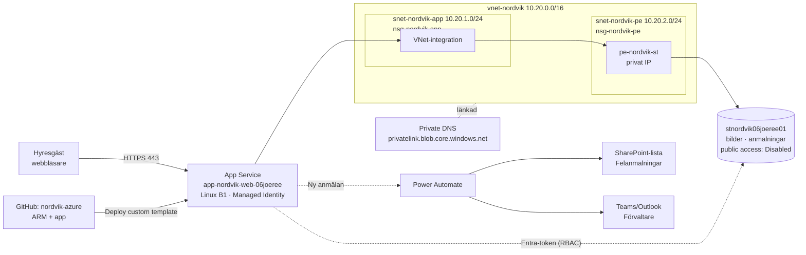

# Nordvik – Hyresgästportal med felanmälan i Azure

**Författare:** Joel Reed (06joeree) · **Prenumeration:** Azure free trial · **Resursgrupp:** `rg-nordvik` (Sweden Central)
**Repo:** https://github.com/Habibijoel/nordvik-azure

> Arbetet är gjort med AI-stöd (Grok Bot) med lärarens godkännande, som test av verktyget.

---

## Del A – Dokumentation

### Centrala Azure-tjänster

| Område | Tjänst | Användning hos Nordvik |
|---|---|---|
| Compute | **Azure App Service (Linux, B1)** + App Service Plan `asp-nordvik` | Kör portalen (Python/Flask) |
| Compute (alternativ) | Virtual Machines, Container Apps/AKS, Azure Functions | Utvärderade, ej valda (se nedan) |
| Nätverk | **Virtual Network** `vnet-nordvik` (10.20.0.0/16) | Två subnät: `snet-nordvik-app` (VNet-integration) och `snet-nordvik-pe` (private endpoint) |
| Nätverk | **Network Security Groups** `nsg-nordvik-app`, `nsg-nordvik-pe` | Filtrerar trafik per subnät |
| Nätverk | **Private Endpoint** `pe-nordvik-st` + **Private DNS** `privatelink.blob.core.windows.net` | Lagringen nås bara via privat IP i VNet |
| Storage | **Storage Account** `stnordvik06joeree01` (StorageV2, LRS, Hot) | Blob-containrar `bilder` och `anmalningar` |
| Identitet | **Microsoft Entra ID**, **hanterad identitet**, **Azure RBAC** | Inga lösenord/nycklar i koden |

### Virtualiseringsnivåer

| Nivå | Vad man hanterar själv | Fördelar | Nackdelar |
|---|---|---|---|
| **VM (IaaS)** | OS, patchning, webbserver, runtime, app | Full kontroll | Mest drift, säkerhetsuppdateringar, högre kostnad per nytta |
| **Containers** (Container Apps/AKS) | Image, runtime, orkestrering (delvis) | Portabelt, skalbart | Kräver registry, image-pipeline, mer kunskap |
| **Serverless** (Functions) | Bara kod | Betala per anrop, skalar till noll | Kallstart, mindre lämpat för en webbportal med UI, mer utvecklingsarbete |
| **PaaS** (App Service) | Kod + konfiguration | Microsoft patchar OS/runtime, inbyggd HTTPS, VNet-integration, hanterad identitet | Mindre kontroll än VM |

**Val: App Service (PaaS) på Linux B1.** Motivering:
- **Säkerhet:** Microsoft patchar OS och runtime – ingen öppen SSH/RDP-port som på en VM.
- **Kostnad:** B1 ≈ 13 USD/mån, förutsägbart; en VM B1s + disk + publik IP + drifttid blir dyrare i praktiken.
- **Enkelhet:** Nordvik är ett litet fastighetsbolag utan egen driftavdelning – PaaS passar.
- B1 är lägsta nivå som stöder **VNet-integration**, vilket krävs för att nå lagringen privat. (Free/F1 stöder inte detta.)

---

## Del B – Praktisk lösning

### Arkitektur



### Namngivning
Mönster `typ-foretag-syfte`, utan å/ä/ö: `rg-nordvik`, `vnet-nordvik`, `snet-nordvik-app`, `snet-nordvik-pe`, `nsg-nordvik-app`, `nsg-nordvik-pe`, `asp-nordvik`, `app-nordvik-web-06joeree`, `pe-nordvik-st`, `stnordvik06joeree01`.
*Avvikelse:* webbappens namn blir en publik URL (`*.azurewebsites.net`) och måste vara globalt unikt, därför suffixet `-06joeree` (samma logik som storage-namnet, eftersom hela klassen bygger samma lösning).

---

### Delmoment 1 – Compute
App Service Plan `asp-nordvik` (Linux, B1) och webbapp med Python 3.11. Koden hämtas från GitHub-repots `app/`-mapp via `sourcecontrols` (manuell integration) och byggs av Oryx (`SCM_DO_BUILD_DURING_DEPLOYMENT=true`, `PROJECT=app`). Start: `gunicorn app:app`.

Formuläret har fälten **rubrik**, **beskrivning** och **bild** (JPG/PNG/WEBP, max 5 MB). Utdrag ur `app/app.py`:

```python
svc = BlobServiceClient(os.environ["STORAGE_ACCOUNT_URL"], credential=DefaultAzureCredential())
svc.get_blob_client("bilder", bildnamn).upload_blob(bild.stream)
svc.get_blob_client("anmalningar", f"{rid}.json").upload_blob(json.dumps(doc))
```

**Verifiering:** öppna `appUrl` → formuläret visas; `/health` svarar `ok`. Portal → webbappen → *Deployment Center* visar lyckad deploy.

---

### Delmoment 2 – IAM (least privilege)

**Rollmodell för Nordvik:**

| Roll | Entra-grupp | Behörighet i portal/data | Azure RBAC |
|---|---|---|---|
| Hyresgäst | (extern/B2C, se avgränsning) | Skapa och se **egna** anmälningar | Ingen – endast via appen |
| Förvaltare | `SEC_Skötsel` (+ ev. `SEC_Uthyrning`) | Hantera alla anmälningar (status, tilldelning) i SharePoint-listan | Ingen Azure-roll behövs; *Edit* på SharePoint-listan |
| Ekonomi | `SEC_Ekonomi` | Läsande insyn | **Reader** på `rg-nordvik` (parameter `ekonomiGroupObjectId`) + *Read* på SharePoint-listan |
| Ledning | `SEC_Ledning` | Läsande insyn/rapporter | Reader (manuellt vid behov) |
| IT/ägare | Joel (Owner) | Administration | Owner på prenumerationen |
| **Portalen** | System-assigned managed identity | Läsa/skriva blobbar | **Storage Blob Data Contributor** – endast på storage-kontot |

Viktiga val:
- Portalen har **ingen nyckel eller connection string** – `allowSharedKeyAccess: false` gör nycklar oanvändbara; bara Entra-token fungerar.
- Rollen är satt på **storage-kontots scope**, inte resursgrupp/prenumeration.
- Människor får **inte** dataroller på lagringen – de arbetar via appen och SharePoint. Det minimerar attackytan.
- "Hyresgäst ser bara egna": styrs i applagret. *Avgränsning:* prototypen har ingen inloggning för hyresgäster. Nästa steg är **App Service Authentication (Easy Auth) med Entra External ID**, där appen sparar inloggad användares `oid` i JSON-dokumentet och filtrerar listan på den.

**Verifiering:** Storage-kontot → *Access control (IAM)* → *Role assignments* visar webbappen som Storage Blob Data Contributor. Resursgruppen → IAM visar SEC_Ekonomi som Reader (om parametern angetts). Webbappen → *Identity* → Status *On*.

---

### Delmoment 3 – Nätverk och säkerhet (defense in depth)

| Lager | Åtgärd |
|---|---|
| Identitet | Entra ID, managed identity, RBAC, inga nycklar |
| Perimeter | Endast HTTPS (`httpsOnly`), TLS 1.2, FTP/FTPS och basic publishing-autentisering avstängda |
| Nätverk | VNet med segmenterade subnät + NSG:er; NSG på PE-subnätet tillåter bara 443 från app-subnätet |
| Data/endpoint | Storage `publicNetworkAccess: Disabled`, private endpoint, privat DNS, `vnetRouteAllEnabled` så all utgående trafik går via VNet |
| Data | Ingen anonym blob-åtkomst, kryptering i vila (standard), soft delete 7 dagar |
| Applikation | Validering av filtyp/storlek, längdbegränsning av fält |

Portalen är publikt nåbar (hyresgäster ska kunna anmäla hemifrån), men lagringen går inte att nå från internet alls.

*Ej med (kostnad):* Application Gateway/Front Door med WAF (~20–300 USD/mån), Defender for Cloud-planer. Rekommenderas vid produktion.

**Verifiering:**
- Storage → *Networking* → *Public network access: Disabled*; *Private endpoint connections* → `pe-nordvik-st` *Approved*.
- Försök öppna `https://stnordvik06joeree01.blob.core.windows.net/bilder?restype=container` från egen dator → *AuthorizationFailure/403*.
- Webbapp → *Advanced Tools (Kudu)* → SSH: `nslookup stnordvik06joeree01.blob.core.windows.net` ger 10.20.2.x.

---

### Delmoment 4 – Storage
`stnordvik06joeree01` (StorageV2, Standard_LRS – billigast, räcker för en prototyp). Containrar:
- `bilder` – uppladdade bilder (`<uuid>.jpg`)
- `anmalningar` – ett JSON-dokument per anmälan:

```json
{"id":"…","rubrik":"Läckande kran","beskrivning":"…","bild":"….jpg","status":"Ny","skapad":"2026-10-11T18:00:00Z"}
```

Blob valdes framför SQL/Cosmos DB för att det är billigast och räcker för volymen (några hundra lägenheter). SharePoint-listan blir förvaltarnas arbetsyta.

**Verifiering:** skicka en anmälan med bild → den visas i listan med bild. (Portalens Storage browser visar *inte* innehållet utifrån eftersom publik åtkomst är avstängd – det bevisar skyddet.)

---

### Delmoment 5 – IaC (ARM + GitHub)
Allt i `azuredeploy.json` (en deploy, RG-scope). Återskapas så här:

1. Portal → **Resource groups → Create** → `rg-nordvik`, Sweden Central.
2. Klicka *Deploy to Azure* i README, eller **Deploy a custom template → Build your own template in the editor** → klistra in `azuredeploy.json` → Save.
3. Parametrar:

```text
storageAccountName   = stnordvik06joeree01
appName              = app-nordvik-web-06joeree
repoUrl              = https://github.com/Habibijoel/nordvik-azure
branch               = main
ekonomiGroupObjectId = <objectId för SEC_Ekonomi, eller tomt>
```

4. **Review + create**. Output `appUrl` visar adressen.

Objectid för SEC_Ekonomi: Entra ID → Groups → SEC_Ekonomi → *Object ID*.

Mallen är idempotent – att köra om den uppdaterar i stället för att duplicera. Ändringar görs i repot (commit), sedan omdeploy.

**Verifiering:** Resursgrupp → *Deployments* → status *Succeeded*. Ta bort RG och kör om → identisk miljö.

---

### Delmoment 6 – Automation och integration (Power Automate)

**Flöde:** Ny felanmälan → post i SharePoint-listan *Felanmalningar* → notis till förvaltare i Teams (och Outlook).

Eftersom lagringen är privat kan Power Automate inte läsa blobbarna direkt. Därför används en **Microsoft Forms**-/HTTP-trigger. Rekommenderad, enkel variant med standardlicens (M365 Business Premium):

**1. SharePoint-lista** (webbplats t.ex. *Nordvik Förvaltning*), lista `Felanmalningar`:

| Kolumn | Typ |
|---|---|
| Title (Rubrik) | Text |
| Beskrivning | Flera textrader |
| Status | Val: Ny, Pågår, Klar (standard Ny) |
| Anmalningsid | Text |
| Bild | Hyperlänk |
| Ansvarig | Person (SEC_Skötsel) |

Behörigheter: SEC_Skötsel = *Edit*, SEC_Ekonomi + SEC_Ledning = *Read*.

**2. Flöde i Power Automate** (make.powerautomate.com → *Create → Automated cloud flow*):

Alternativ A (Premium, HTTP-trigger): *When an HTTP request is received* – appen POST:ar JSON efter sparandet. Schema:

```json
{"type":"object","properties":{"id":{"type":"string"},"rubrik":{"type":"string"},"beskrivning":{"type":"string"},"bild":{"type":"string"}}}
```

Alternativ B (standardlicens – vald för prototypen): Formuläret skickar även ett mejl till den delade brevlådan `felanmalan@…`, trigger *When a new email arrives (V3)* i Office 365 Outlook, med filter på ämnet "Felanmälan:".

Steg efter triggern:
1. **SharePoint – Create item**: Site = Nordvik Förvaltning, List = Felanmalningar, Title = `rubrik`, Beskrivning = `beskrivning`, Status = Ny, Anmalningsid = `id`.
2. **Microsoft Teams – Post message in a chat or channel**: Post as *Flow bot*, Team *Nordvik Förvaltning*, Kanal *Felanmälningar*, Meddelande:
   ```text
   Ny felanmälan: @{triggerBody()?['rubrik']}
   @{triggerBody()?['beskrivning']}
   Öppna listan: <länk till Felanmalningar>
   ```
3. (Valfritt) **Office 365 Outlook – Send an email (V2)** till gruppen SEC_Skötsel.

*Antagande:* HTTP-anropet från appen till flödet är inte implementerat i prototypkoden (det kräver Premium-licens eller extra mejlintegration); kopplingen beskrivs och flödet testas med manuell trigger.

**Verifiering:** *Test → Manually* i flödet → ny post i listan och meddelande i Teams-kanalen. Flödets *Run history* visar *Succeeded*.

---

### Delmoment 7 – Dokumentation: planering, implementation, återskapande

**Planering:** Kravanalys (portal publik, data skyddad, tre roller) → val av PaaS → nätverksdesign med privat endpoint → IaC i en mall → M365-integration.
**Implementation:** (1) Förkrav: användare, licenser och SEC-grupper i Entra. (2) `rg-nordvik`. (3) Kod och ARM i GitHub. (4) Deploy via *custom template*. (5) Verifiering. (6) Power Automate-flöde.
**Återskapande:** se Delmoment 5 – allt utom Entra-användare och Power Automate/SharePoint skapas av mallen.

### Kostnad (ungefärlig, Sweden Central)

| Resurs | ~kostnad/mån |
|---|---|
| App Service B1 Linux | ~13 USD |
| Private endpoint | ~7 USD + trafik |
| Private DNS zone | ~0,5 USD |
| Storage LRS (få GB) | < 1 USD |
| VNet, NSG | 0 |
| **Totalt** | **~22 USD** (täcks av free trial-krediten) |

Tips: ta bort `rg-nordvik` efter bedömning för att inte förbruka krediten.

### Nordvik jämfört med Novatrix
*Antagande:* Novatrix är kursens tidigare exempelföretag (t.ex. ett internt/teknikbolag). Nordvik skiljer sig så här och det syns i designen:
- **Externa användare (hyresgäster)** → portalen måste vara publik, därför HTTPS-only och tydlig separation app/data.
- **Personuppgifter och bilder från hem** (GDPR) → privat lagring, ingen anonym åtkomst, soft delete, region Sweden Central.
- **Litet bolag utan IT-avdelning** → PaaS i stället för VM, låg fast kostnad.
- **Verksamheten bor i Microsoft 365** (SharePoint/Teams) → förvaltarnas arbetsflöde i M365 i stället för i en egen admin-app.

### Avgränsningar
- Ingen hyresgästinloggning i prototypen (Easy Auth + Entra External ID nästa steg).
- Ingen WAF/Front Door (kostnad).
- Power Automate-trigger från appen beskriven men ej kodad.
- LRS, ingen geo-redundans.

### Verifieringschecklista

| # | Delmoment | Kontroll | ✓ |
|---|---|---|---|
| 1 | Compute | `appUrl` visar formuläret, `/health` = ok | ☐ |
| 2 | IAM | MI = Storage Blob Data Contributor på storage; SEC_Ekonomi = Reader | ☐ |
| 3 | Nätverk | Storage public access Disabled, PE Approved, 403 utifrån, nslookup → 10.20.2.x | ☐ |
| 4 | Storage | Anmälan med bild sparas och visas | ☐ |
| 5 | IaC | Deployment *Succeeded*, mall i GitHub | ☐ |
| 6 | Automation | Testkörning skapar listpost + Teams-notis | ☐ |
| 7 | Dokumentation | Denna rapport + README | ☐ |
